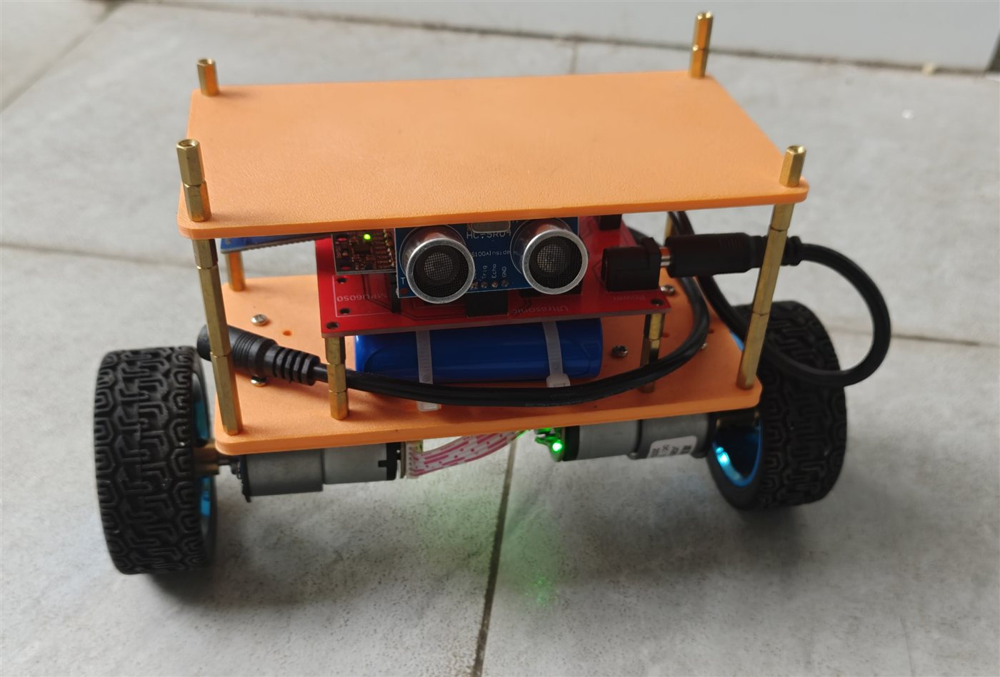
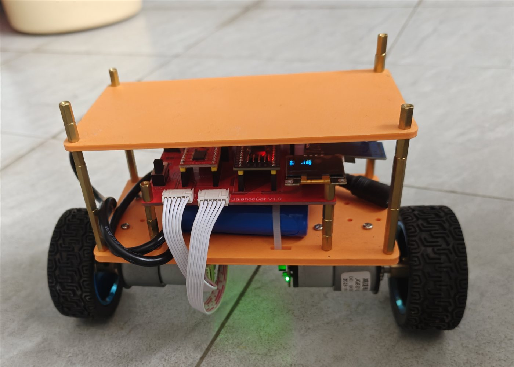

# 🤖 STM32 Two-Wheel Self-Balancing Robot

**English** | [简体中文](README_zh.md)

A two-wheel self-balancing robot built on an **STM32F103C8T6**. MPU6050 attitude
sensing + three-loop cascaded PID, it stands up the moment you power it on.

The same hardware is implemented **twice**, side by side:

| Version | Directory | Library | Status |
|:---|:---|:---|:---|
| Standard Peripheral Library | [`std/`](std/) | STM32F10x StdPeriph | ✅ complete |
| HAL Library | [`hal/`](hal/) | STM32CubeMX + HAL | ✅ runs (no ultrasonic) |


<p align="center">
  
</p>

---

## 💡 Why this repository

Most balance-car projects only exist in one flavor. "StdPeriph or HAL?" is one of
the most common questions from people learning STM32 — so this repo answers it
with two working implementations of the **exact same robot**, same wiring, same
control law, same gains.

Differences are deliberate and documented, not accidental:

| | `std/` | `hal/` |
|:---|:---|:---|
| Control tick source | MPU6050 INT (PB5) → EXTI falling edge | **TIM3 timer interrupt**, PSC=71 / ARR=4999 → 200 Hz |
| PB5 | used | **unused** |
| OLED bus | software I2C | **hardware I2C1** (PB8/PB9, requires I2C1 remap) |
| MPU6050 bus | software I2C (PB3/PB4) | software I2C (PB3/PB4, DWT-based µs delay) |
| Ultrasonic ranging | ✅ HC-SR04 | ❌ not implemented |
| Bluetooth remote | single-byte command, latched | latched + ramped acceleration + optional link-loss guard |
| Configuration source | hand-written | `hal/balance_car.ioc` (CubeMX) |

---

## ✨ Features

**Shared by both versions**

- Stands up on power-on and recovers after being pushed
- Three cascaded loops: balance PD + speed PI + turn PD
- 5 ms control period (200 Hz balance loop, 50 Hz speed loop)
- Encoders read through the timer quadrature interface in hardware — zero CPU cost
- JDY-31 (BLE) Bluetooth remote over USART3
- Automatic motor cut-off when tilt exceeds 60°
- Anti-windup on the speed integrator; DMP read failures and FIFO backlog are handled explicitly

**`std/` version only**

- HC-SR04 ultrasonic ranging, distance shown on the OLED
- Control interrupt generated by the MPU6050 INT pin (PB5 / EXTI_Line5)
- Software I2C for the OLED

**`hal/` version only**

- Control interrupt generated by TIM3 (200 Hz) — does not depend on the MPU6050 INT pin
- Hardware I2C1 for the OLED
- Bluetooth remote with latched command, ramped speed/turn targets, and an optional link-loss stop

---

## 🛠 Hardware

| Module | Part | Notes |
|:---|:---|:---|
| MCU | STM32F103C8T6 | minimum system board |
| IMU | MPU6050 | with INT pin, 3.3 V supply |
| Motors | 520 gear motor ×2 | with AB hall encoders, mirror-mounted |
| Motor driver | TB6612FNG | dual H-bridge |
| Display | 0.96" OLED | SSD1306, I2C |
| Ranging | HC-SR04 | ultrasonic (**`std/` only**) |
| Bluetooth | JDY-31 | BLE UART pass-through, 9600 baud |
| Power | 18650 pack, 7.4 V | motors and MCU powered separately, **common ground required** |

---

## 🔌 Pinout

| Pin | Peripheral | Function | Version notes |
|:---|:---|:---|:---|
| `PA8` / `PA11` | left / right motor | PWM (TIM1_CH1 / CH4) | same |
| `PB14` `PB15` | left motor | direction AIN1 / AIN2 | same |
| `PB13` `PB12` | right motor | direction BIN1 / BIN2 | same |
| `PA0` `PA1` | left encoder | TIM2 quadrature | same |
| `PB6` `PB7` | right encoder | TIM4 quadrature | same |
| `PB3` / `PB4` | MPU6050 | software I2C SCL / SDA | same |
| `PB5` | MPU6050 INT | EXTI_Line5 falling | `std/` triggers the control ISR here; **`hal/` does not use it** |
| `PA3` / `PA2` | HC-SR04 | TRIG / ECHO | **`std/` only** |
| `PB8` / `PB9` | OLED | SCL / SDA | `std/` software I2C; `hal/` hardware I2C1 (remapped) |
| `PB10` / `PB11` | Bluetooth | USART3 @ 9600 | same |
| `PA9` / `PA10` | debug UART | USART1 @ 115200 | `hal/` initialised, currently unused |

Full BOM: [`documents/hardware.md`](documents/hardware.md).

> ⚠️ Both versions disable JTAG to free PB3/PB4 for the MPU6050 software I2C.
> **Flashing must use SWD**, not JTAG.

---

## 🎬 Demo

Click a picture to watch the video (GitHub strips relative `<video>` tags, so the
videos are linked rather than embedded):

| Self-balancing | Bluetooth remote |
|:---:|:---:|
| [](docs/media/demo_self_balance.mp4) | [](docs/media/demo_bluetooth.mp4) |

- 🎥 [Self-balancing demo](docs/media/demo_self_balance.mp4)
- 🎥 [Bluetooth remote demo](docs/media/demo_bluetooth.mp4)

---

## 🚀 Quick start

**Environment**

- Keil MDK-ARM (uVision 5)
- STM32F1 device family pack (`Keil::STM32F1xx_DFP`)
- ST-Link probe

**Clone**

```bash
git clone https://github.com/dcy288773/stm32-balance-car.git
```

### Build the StdPeriph version

1. Open `std/USER/UpStanding_Car.uvprojx`
2. Press **F7** — should report `0 Error(s)`
3. Press **F8** to flash
4. Power on — the robot stands up by itself

Prebuilt firmware: `std/firmware/UpStanding_Car.hex`.

### Build the HAL version

1. *(optional)* Open `hal/balance_car.ioc` with STM32CubeMX to modify peripherals
2. Open `hal/MDK-ARM/balance_car.uvprojx`
3. Make sure **Options for Target → Target → Use MicroLIB** is checked (`sprintf` needs it)
4. Press **F7** — should report `0 Error(s), 0 Warning(s)`
5. Press **F8** to flash (SWD)

Current footprint:

```
Code=23856  RO-data=5368  RW-data=276  ZI-data=2668
```

> Regenerating from CubeMX overwrites `hal/MDK-ARM/*.uvprojx`, wipes the `MyAPP`
> file group and include paths in Keil, and unchecks MicroLIB. All three must be
> restored by hand afterwards.

---

## 🧠 Control structure

```
TIM3 interrupt @200 Hz (5 ms)              [std/: PB5 EXTI]
        │
        ├─ read DMP FIFO (attitude + calibrated gyro in one transaction)
        │
        ├─ every 4th call → Velocity() @50 Hz (20 ms)
        │      output Velocity_out (in degrees) shifts the balance setpoint
        │
        ├─ Vertical() @200 Hz   PD on (angle − Med_Angle) and gyro Y
        ├─ Turn()     @200 Hz   PD on gyro Z and the remote steering target
        │
        └─ MOTO1 = PWM − Turn_out
           MOTO2 = PWM + Turn_out  → Limit() → Load()
```

**Safety and robustness**

- DMP read failure: that speed window is discarded; two consecutive failures cut the motors
- FIFO backlog: cleared, and the speed-loop measurement window is restarted
- Tilt over 60°: motor output cut immediately
- Output saturation is detected *before* clamping, so the integrator stops winding up

---

## 📊 PID parameters

Both versions use the same gains:

| Parameter | Value | Loop | Purpose |
|:---|---:|:---|:---|
| `Med_Angle` | `0` | — | mechanical centre, **calibrate first** |
| `Vertical_Kp` | `-400` | balance | too small and it cannot stand |
| `Vertical_Kd` | `-1.92` | balance | damps oscillation |
| `Velocity_Kp` | `-0.44` | speed | stops continuous drift |
| `Velocity_Ki` | `-0.0022` | speed | removes steady-state error |
| `Turn_Kp` | `20` | turn | keeps it going straight |
| `Turn_Kd` | `0.6` | turn | damps yaw oscillation |

Where to find them:

- StdPeriph: `std/HARDWARE/CONTROL/control.c`
- HAL: `hal/MyAPP/pid.c`

**The signs are not arbitrary.** They encode the empirically verified polarity of
this chassis; flipping them makes the robot fall over immediately.

Tuning order: mechanical centre → `Vertical_Kp` → `Vertical_Kd` → `Velocity_Kp/Ki`
→ `Turn_Kp/Kd`. Do not skip steps. Details: [`documents/tuning.md`](documents/tuning.md).

---

## 📁 Repository layout

```
stm32-balance-car/
├── documents/      hardware BOM and tuning guide (shared)
├── docs/           photos and demo videos
├── std/            ✅ Standard Peripheral Library version
│   ├── CORE/           CMSIS core and startup
│   ├── STM32F10x_FWLib/ ST standard peripheral library
│   ├── SYSTEM/         delay / sys / usart
│   ├── HARDWARE/       CONTROL ENCODER MOTOR PWM EXTI
│   │                   MPU6050 OLED SENSOR USART3
│   ├── USER/           main.c and Keil project
│   └── firmware/       prebuilt hex
└── hal/            ✅ HAL version (CubeMX project)
    ├── Core/           CubeMX-generated main / peripheral init / IRQ
    ├── Drivers/        HAL + CMSIS
    ├── MyAPP/          user code: pid / motor / encoder / bluetooth
    │                   mpu6050 / IIC / ssd1306
    └── MDK-ARM/        Keil project
```

---

## 🗺 Roadmap

- [ ] Ultrasonic ranging for the HAL version
- [ ] DMP-free attitude estimation (complementary filter) for comparison
- [ ] FreeRTOS port of the HAL version
- [ ] Mobile app for the Bluetooth remote

---

## 🙏 Third-party code

Sources bundled from STMicroelectronics, ARM CMSIS, InvenSense eMPL and
afiskon/stm32-ssd1306 keep their own licenses. See
[`THIRD_PARTY_NOTICES.md`](THIRD_PARTY_NOTICES.md) for details.

---

## 📄 License

Everything written and organized by the repository owner is released under the
**MIT License** — see [LICENSE](LICENSE).
