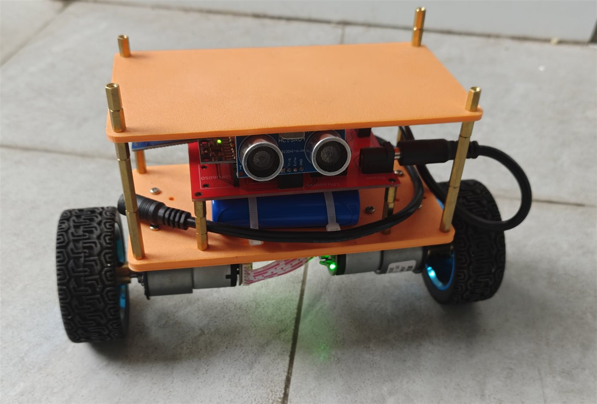
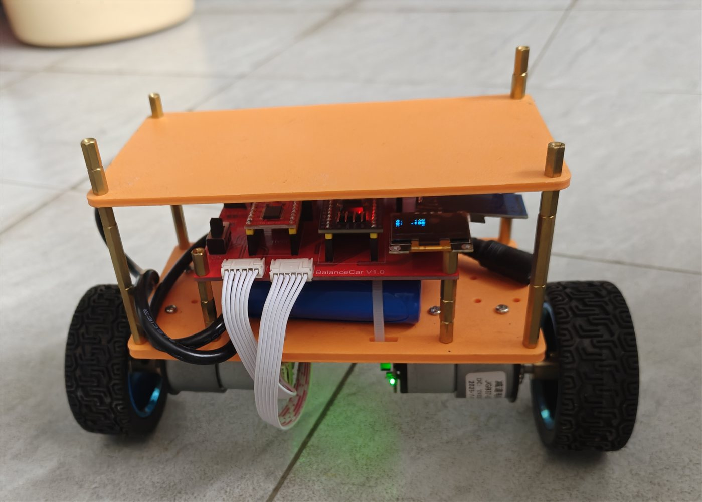

# 🤖 两轮自平衡小车

[English](README.md) | **简体中文**

基于 **STM32F103C8T6** 的两轮自平衡小车。MPU6050 姿态解算 + 三闭环 PID 控制，上电即站立。

同一套硬件提供了**两个版本**的实现，并排放在同一个仓库里：

| 版本 | 目录 | 库 | 状态 |
|:---|:---|:---|:---|
| 标准外设库版 | [`std/`](std/) | STM32F10x StdPeriph | ✅ 已完成 |
| HAL 库版 | [`hal/`](hal/) | STM32CubeMX + HAL | ✅ 可运行（未实现超声波） |


<p align="center">
  
</p>

---

## 💡 为什么有这两个版本

「学 STM32 该学标准库还是 HAL？」是初学者最常问的问题之一。与其争论，不如用**同一辆车、同一套接线、同一套控制律、同一组参数**，把两种写法都实现一遍，直接对照。

差异是刻意保留的，并且写进了文档：

| | `std/` | `hal/` |
|:---|:---|:---|
| 控制节拍来源 | MPU6050 INT（PB5）EXTI 下降沿 | **TIM3 定时器中断**，PSC=71 / ARR=4999 → 200 Hz |
| PB5 | 使用 | **未使用** |
| OLED 总线 | 软件 I2C | **硬件 I2C1**（PB8/PB9，需 I2C1 重映射） |
| MPU6050 总线 | 软件 I2C（PB3/PB4） | 软件 I2C（PB3/PB4，DWT 微秒延时） |
| 超声波测距 | ✅ HC-SR04 | ❌ 未实现 |
| 蓝牙遥控 | 单字节指令，指令锁存 | 锁存 + 斜坡加减速 + 可选失联保护 |
| 配置来源 | 手写 | `hal/balance_car.ioc`（CubeMX） |

---

## ✨ 功能特性

**两个版本共有**

- 上电自主站立，被推后自行恢复
- 三闭环串级 PID：直立环 PD + 速度环 PI + 转向环 PD
- 直立环控制周期 5 ms（200 Hz），速度环 50 Hz
- 编码器使用定时器编码器接口模式，硬件自动计数，不占用 CPU
- USART3 蓝牙遥控（JDY-31 BLE 串口透传）
- 倾角超过 60° 自动切断电机输出，保护硬件
- 速度环抗积分饱和；DMP 读失败与 FIFO 积压都有明确处理策略

**仅标准库版（`std/`）**

- HC-SR04 超声波测距，OLED 显示车身角度、超声波距离、车轮转速
- 控制中断由 MPU6050 的 INT 引脚（PB5 / EXTI_Line5）触发
- OLED 使用软件 I2C

**仅 HAL 版（`hal/`）**

- 控制中断由 TIM3 定时器产生（200 Hz），不依赖 MPU6050 的 INT 引脚
- OLED 使用硬件 I2C1
- 蓝牙遥控支持指令锁存、斜坡加减速，并预留可选失联保护

---

## 🛠 硬件要求

| 模块 | 型号 | 说明 |
|:---|:---|:---|
| 主控 | STM32F103C8T6 | 最小系统板 |
| 姿态传感器 | MPU6050 | 需带 INT 引脚，3.3V 供电 |
| 电机 | 520 减速电机 ×2 | 带 AB 相霍尔编码器，左右对称安装 |
| 电机驱动 | TB6612FNG | 双路 H 桥 |
| 显示 | 0.96 寸 OLED | SSD1306，I2C 接口 |
| 测距 | HC-SR04 | 超声波模块（**仅 `std/` 版驱动**） |
| 蓝牙 | JDY-31 | BLE 串口透传，9600 |
| 电源 | 18650 电池组 7.4V | 电机与主控分开供电，**必须共地** |

完整物料清单见 [`documents/hardware.md`](documents/hardware.md)。

---

## 🔌 硬件连接

| STM32 引脚 | 外设 | 功能 | 版本差异 |
|:---|:---|:---|:---|
| `PA8` / `PA11` | 左轮 / 右轮 | PWM（TIM1_CH1 / CH4） | 两版相同 |
| `PB14` `PB15` | 左轮 | 方向控制 AIN1 / AIN2 | 两版相同 |
| `PB13` `PB12` | 右轮 | 方向控制 BIN1 / BIN2 | 两版相同 |
| `PA0` `PA1` | 左轮编码器 | TIM2 编码器接口 | 两版相同 |
| `PB6` `PB7` | 右轮编码器 | TIM4 编码器接口 | 两版相同 |
| `PB3` / `PB4` | MPU6050 | 软件 I2C SCL / SDA | 两版相同 |
| `PB5` | MPU6050 INT | EXTI_Line5 下降沿 | `std/` 用它触发控制中断；**`hal/` 未使用** |
| `PA3` / `PA2` | HC-SR04 | TRIG / ECHO | **仅 `std/` 版驱动** |
| `PB8` / `PB9` | OLED | SCL / SDA | `std/` 软件 I2C；`hal/` 硬件 I2C1 |
| `PB10` / `PB11` | 蓝牙 | USART3，9600 | 两版相同 |
| `PA9` / `PA10` | 调试串口 | USART1，115200 | `hal/` 已初始化但当前未使用 |

> ⚠️ 两版都会禁用 JTAG 以释放 PB3/PB4 作 MPU6050 的软件 I2C，下载必须使用 **SWD**。

---

## 🎬 演示

点图片看视频（GitHub 会剥掉仓库内相对路径的 `<video>` 标签，所以这里用链接）：

| 自平衡 | 蓝牙遥控 |
|:---:|:---:|
| [](docs/media/demo_self_balance.mp4) | [](docs/media/demo_bluetooth.mp4) |

- 🎥 [自平衡演示](docs/media/demo_self_balance.mp4)
- 🎥 [蓝牙遥控演示](docs/media/demo_bluetooth.mp4)

---

## 🚀 快速开始

**软件环境**

- Keil MDK-ARM（uVision5）
- STM32F1 器件支持包（`Keil::STM32F1xx_DFP`）
- ST-Link 下载器

**获取代码**

```bash
git clone https://github.com/dcy288773/stm32-balance-car.git
```

### 编译标准库版

1. 打开 `std/USER/UpStanding_Car.uvprojx`
2. 按 **F7** 编译，应显示 `0 Error(s)`
3. 按 **F8** 下载到开发板
4. 上电，小车自行站立

不想编译可直接烧录 `std/firmware/UpStanding_Car.hex`。

### 编译 HAL 版

1. （可选）用 STM32CubeMX 打开 `hal/balance_car.ioc` 修改外设配置
2. 打开 `hal/MDK-ARM/balance_car.uvprojx`
3. 确认 `Options for Target → Target` 里勾选了 **Use MicroLIB**（`sprintf` 依赖它）
4. 按 **F7** 编译，应显示 `0 Error(s), 0 Warning(s)`
5. 按 **F8** 下载（必须用 SWD）

当前编译产物：

```
Code=23856  RO-data=5368  RW-data=276  ZI-data=2668
```

> ⚠️ CubeMX 重新生成代码会覆盖 `hal/MDK-ARM/*.uvprojx`、清空 Keil 里的 `MyAPP`
> 文件组和头文件路径、并取消 MicroLIB 勾选。生成后必须手工恢复这三项。

---

## 🧠 控制结构

```
TIM3 定时中断 @200Hz (5ms)              [std/ 版：PB5 EXTI]
        │
        ├─ 读 DMP FIFO（一次读取同时得到姿态角与校准后的角速度）
        │
        ├─ 每 4 次 → 速度环 Velocity() @50Hz（20ms）
        │      输出 Velocity_out（单位：度）叠加到直立环目标角
        │
        ├─ 直立环 Vertical() @200Hz   PD：(角度 − Med_Angle) 与 gyro Y
        ├─ 转向环 Turn()     @200Hz   PD：gyro Z 与遥控转向目标
        │
        └─ MOTO1 = PWM − Turn_out
           MOTO2 = PWM + Turn_out  → Limit() → Load()
```

**安全和异常处理**

- DMP 读失败：丢弃该次速度窗口；连续失败 2 次判定姿态源失效，立即停机
- FIFO 积压：清空并重开速度环测量窗口，不用旧姿态控车
- 倾角超过 60°：立即切断电机输出
- 输出饱和在限幅**之前**判断，速度环据此做抗积分饱和

---

## 📊 PID 参数

两个版本的参数取值相同：

| 参数 | 值 | 环 | 作用 |
|:---|---:|:---|:---|
| `Med_Angle` | `0` | — | 机械中值，**最先调，是标定值** |
| `Vertical_Kp` | `-400` | 直立环 | 太小站不起来 |
| `Vertical_Kd` | `-1.92` | 直立环 | 抑制抖动 |
| `Velocity_Kp` | `-0.44` | 速度环 | 防止持续跑偏 |
| `Velocity_Ki` | `-0.0022` | 速度环 | 消除稳态误差 |
| `Turn_Kp` | `20` | 转向环 | 走直线 |
| `Turn_Kd` | `0.6` | 转向环 | 抑制转向抖动 |

参数位置：

- 标准库版：`std/HARDWARE/CONTROL/control.c`
- HAL 版：`hal/MyAPP/pid.c`

**正负号不是随便写的**——它们对应这辆车实测出来的极性约定，改了车会直接倒。

**调参顺序**：机械中值 → 直立环 Kp → 直立环 Kd → 速度环 Kp/Ki → 转向环 Kp/Kd。顺序不能跳。

详细步骤见 [`documents/tuning.md`](documents/tuning.md)。

---

## 📁 项目结构

```
stm32-balance-car/
├── documents/      硬件清单与调参说明（两版共用）
├── docs/           实物照片与演示视频
├── std/            ✅ 标准外设库版
│   ├── CORE/       CMSIS 内核与启动文件
│   ├── STM32F10x_FWLib/   ST 标准外设库
│   ├── SYSTEM/     delay / sys / usart
│   ├── HARDWARE/   CONTROL ENCODER MOTOR PWM EXTI
│   │               MPU6050 OLED SENSOR USART3
│   ├── USER/       main.c 与 Keil 工程
│   └── firmware/   已编译固件
└── hal/            ✅ HAL 库版（CubeMX 工程）
    ├── Core/       CubeMX 生成的 main / 外设初始化 / 中断
    ├── Drivers/    HAL 库 + CMSIS
    ├── MyAPP/      用户代码：pid / motor / encoder / bluetooth
    │               mpu6050 / IIC / ssd1306
    └── MDK-ARM/    Keil 工程
```

---

## 🗺 路线图

- [ ] HAL 版加入 HC-SR04 超声波测距
- [ ] 加一个不用 DMP 的互补滤波姿态解算，做对照
- [ ] HAL 版移植 FreeRTOS
- [ ] 蓝牙遥控配套手机 App

---

## 🙏 致谢

第三方代码保持各自原始版权声明：`std/STM32F10x_FWLib/` 与 `std/CORE/`
（STMicroelectronics / ARM CMSIS）、`std/HARDWARE/MPU6050/eMPL/` 与
`hal/MyAPP/inv_mpu*.c`（InvenSense Motion Driver）、`hal/MyAPP/ssd1306*`
（[afiskon/stm32-ssd1306](https://github.com/afiskon/stm32-ssd1306)）、
`std/SYSTEM/`（国内 STM32 教学资料通用写法）。仅供学习研究。

详见 [`THIRD_PARTY_NOTICES.md`](THIRD_PARTY_NOTICES.md)。权利人不希望被引用时请提 Issue，立即移除。

---

## 📄 许可

本人编写与整理的部分采用 **MIT License**，详见 [LICENSE](LICENSE)。
